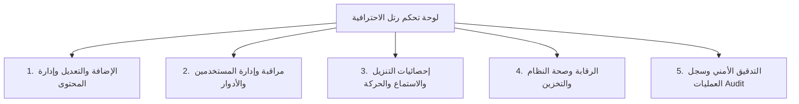
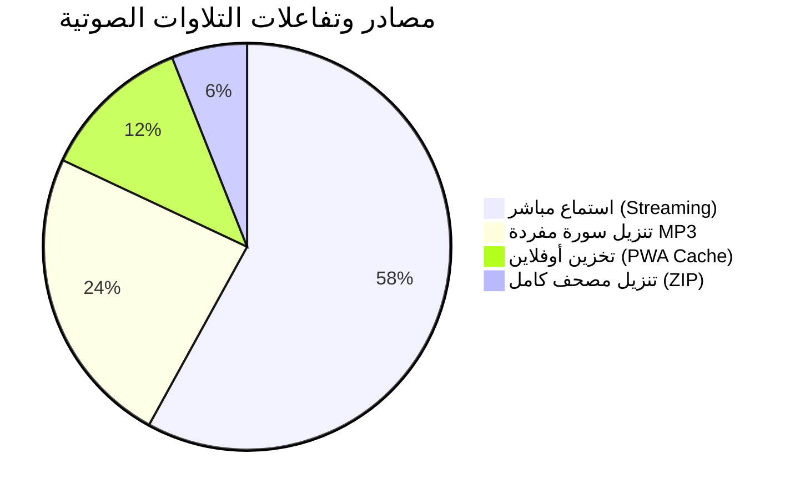
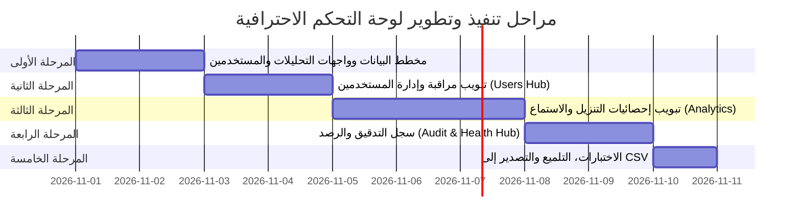

# خطة تطوير لوحة التحكم الشاملة والاحترافية — رتل (Ratil Pro Admin Hub)

> **الرؤية والهدف:** تحويل لوحة تحكم منصة «رتل» من لوحة إدارة مبسطة إلى **مركز قيادة وحوكمة رقمي متكامل (Enterprise-grade Control Center)** لإدارة المحتوى القرآني، مراقبة نشاط المستخدمين، تتبع إحصائيات التنزيل والاستماع المباشر بدقة، وضمان سلامة وموثوقية التخزين السحابي والصوتي.

---

## 1. أركان لوحة التحكم الاحترافية (Core Pillars)



---

## 2. تفصيل المتطلبات الوظيفية (Functional Breakdown)

### الركن الأول: الإضافة والتعديل الشامل (Content & Audio CRUD Hub)

| المكون | الوظائف المطلوبة | القيمة المضافة |
| :--- | :--- | :--- |
| **إدارة القرّاء (Reciters)** | • إضافة قارئ جديد (الاسم، المعرف، الرواية، الترخيص، المصدر، الصورة).<br>• تعديل مباشر لبيانات القارئ وسيرته ومصادره.<br>• التحكم بظهور القارئ للعامة (Toggle Visibility).<br>• فرز وترتيب أولوية الظهور في الصفحة الرئيسية. | مرونة وسرعة في تحديث بيانات المشايخ دون تدخل يدوي في قاعدة البيانات. |
| **إدارة السور والصوتيات (Surahs & Audio)** | • محرر سريع لكل سورة (Inline Modal) لتعديل رابطها واختبارها فوراً.<br>• بذر جماعي ذكي (Smart Bulk Seeding) لكافة سور المصحف الـ 114 بضغطة زر.<br>• التحقق الآلي من صحة الترقيم (`001.mp3`, `01.mp3`, `1.mp3`).<br>• إمكانية ربط ملف توقيت الآيات (Ayah Timings JSON) لتزامن القراءة. | دقة متناهية وسرعة في إدارة وتطبيع آلاف الملفات الصوتية على Archive.org. |
| **المصاحف والروايات (Mus'haf Editions)** | • دعم الروايات المعتمدة (حفص عن عاصم، ورش عن نافع، قالون).<br>• فحص مطابقة بصمات SHA-256 للنصوص القرآنية مع كل تعديل. | ضمان سلامة النص القرآني وعدم المساس بقدسيته وموثوقيته. |

---

### الركن الثاني: مراقبة وإدارة المستخدمين (User Management & Monitoring)

| المكون | الوظائف المطلوبة | القيمة المضافة |
| :--- | :--- | :--- |
| **جدول المستخدمين (Users Table)** | • استعراض قائمة الحسابات المسجلة (الاسم، البريد، الدور، تاريخ الانضمام، آخر نشاط).<br>• البحث بالاسم أو البريد، والفلترة حسب الدور والحالة.<br>• تصدير قائمة المستخدمين (Export CSV). | رؤية واضحة لقاعدة مستخدمي المنصة ونموها. |
| **الأدوار والصلاحيات (RBAC)** | • تحديد الأدوار: `admin` (مدير نظام كامل)، `moderator` (مشرف محتوى)، `user` (مستخدم قارئ).<br>• تعديل رتبة المستخدم أو ترقية المشرفين بنقرة واحدة. | حماية البيانات الحساسة وفصل صلاحيات الحوكمة عن الإشراف. |
| **التحكم بالحسابات (Status Control)** | • تجميد الحسابات المشبوهة أو حظرها (Suspend / Activate).<br>• إعادة تعيين كلمة المرور أو إرسال تنبيهات داخلية.<br>• حذف الحساب نهائياً مع المحافظة على سلامة سجلات التدقيق. | حوكمة أمنية وضمان سلامة المجتمع القرآني للمنصة. |
| **مراقبة الجلسات الحية (Session Pulse)** | • إحصائيات الجلسات الحالية (Active Users Now).<br>• تحليل الأجهزة والمتصفحات الأكثر استخداماً (Mobile vs Desktop, PWA). | تحسين تجربة الاستخدام وتوجيه التحسينات التقنية. |

---

### الركن الثالث: إحصائيات التنزيل والاستماع (Downloads & Streaming Analytics)



1. **مؤشرات الأداء الرئيسية (KPI Cards):**
   - **إجمالي الاستماعات (Total Plays):** عدد مرات تشغيل التلاوات (اليوم / هذا الأسبوع / هذا الشهر).
   - **إجمالي التنزيلات (Total Downloads):** عدد ملفات الـ MP3 المحملة محلياً.
   - **معدل الاستماع المكتمل (Completion Rate):** نسبة الاستماع حتى نهاية السورة.
   - **حجم استهلاك البيانات (Bandwidth Served):** الجيجابايت المستهلكة من Archive.org.
2. **الرسوم البيانية التفاعلية (Visual Charts):**
   - **منحنى الاستماع والتنزيل الزمني (Listen/Download Trends):** رسم بياني خطي يبين ذروة الاستخدام خلال ساعات اليوم وأيام الجمعة والمواسم القرآنية.
   - **أكثر السور طلباً (Top 10 Surahs):** مخطط عمودي يرتب السور الأكثر استماعاً (الكهف، البقرة، يس، الملك...).
   - **أكثر القرّاء استماعاً (Top Reciters):** مقارنة تفاعلية لحجم الإقبال على كل قارئ.
3. **أداة تتبع الأحداث الصامتة (Privacy-Preserving Telemetry):**
   - تسجيل أحداث `listen_start`, `listen_complete`, `download_click` دون تتبع شخصي أو جمع بيانات خاصة (توافقاً مع ميثاق رتل للخصوصية الخالية من الإعلانات والتتبع).

---

### الركن الرابع: الرقابة والتدقيق وصحة النظام (Observability & Audit Logs)

1. **سجل تدقيق العمليات (Audit & Activity Trail):**
   - تسجيل فوري لأي عملية إدارية: (تعديل قارئ، بذر سور، حظر مستخدم، مراجعة بلاغ).
   - توثيق: اسم المسؤول، نوع العملية، التاريخ والوقت، والبيانات قبل وبعد التعديل (Diff).
2. **فحص الصحة الدائم لـ Archive.org وقاعدة البيانات (System Health):**
   - فحص آلي لزمن استجابة روابط Archive.org وقياس زمن الاستجابة (Latency ms).
   - التأكد من دعم الخوادم لـ `Accept-Ranges` لتشغيل ميزة القفز والتزامن في المشغل.
   - مراقبة زمن استعلامات Neon PostgreSQL والتأكد من عدم وجود اختناقات.
3. **مركز فرز ومعالجة البلاغات (Reports Triage Hub):**
   - إدارة بلاغات المستخدمين حول جودة الصوت أو خطأ في النص أو توقيت الآيات.
   - تصنيف الحالات (`new` -> `under_review` -> `resolved`).
   - إمكانية إضافة ملاحظات المدير الداخلية والرد على المُبلّغ.

---

## 3. مخطط قاعدة البيانات المقترح (Schema Enhancements)

لتشغيل هذه الميزات باحترافية، سنقوم بتوسيع مخطط `db/schema.sql` بجداول مخصصة وفعالة:

```sql
-- 1. جدول رتب وحالات المستخدمين
ALTER TABLE users 
  ADD COLUMN IF NOT EXISTS role VARCHAR(20) DEFAULT 'user',      -- 'admin' | 'moderator' | 'user'
  ADD COLUMN IF NOT EXISTS status VARCHAR(20) DEFAULT 'active',   -- 'active' | 'suspended'
  ADD COLUMN IF NOT EXISTS last_login_at TIMESTAMPTZ,
  ADD COLUMN IF NOT EXISTS login_count INTEGER DEFAULT 0;

-- 2. جدول أحداث الاستماع والتنزيل (Analytics)
CREATE TABLE IF NOT EXISTS audio_events (
  id              BIGSERIAL    PRIMARY KEY,
  event_type      VARCHAR(20)  NOT NULL, -- 'play' | 'complete' | 'download'
  reciter_id      VARCHAR(60)  NOT NULL,
  surah_number    SMALLINT     NOT NULL,
  duration_played INTEGER      DEFAULT 0,
  device_type     VARCHAR(20),           -- 'mobile' | 'desktop' | 'tablet'
  created_at      TIMESTAMPTZ  DEFAULT NOW()
);

CREATE INDEX IF NOT EXISTS idx_audio_events_type_date ON audio_events (event_type, created_at DESC);
CREATE INDEX IF NOT EXISTS idx_audio_events_reciter ON audio_events (reciter_id);
CREATE INDEX IF NOT EXISTS idx_audio_events_surah ON audio_events (surah_number);

-- 3. جدول سجل التدقيق الإداري (Audit Logs)
CREATE TABLE IF NOT EXISTS admin_audit_logs (
  id          BIGSERIAL    PRIMARY KEY,
  admin_id    VARCHAR(60)  NOT NULL,
  admin_name  VARCHAR(100),
  action      VARCHAR(50)  NOT NULL, -- 'create_reciter' | 'update_audio' | 'seed_surahs' | 'ban_user'
  target_type VARCHAR(30)  NOT NULL, -- 'reciter' | 'surah' | 'user' | 'report'
  target_id   VARCHAR(100) NOT NULL,
  details     JSONB,
  created_at  TIMESTAMPTZ  DEFAULT NOW()
);

CREATE INDEX IF NOT EXISTS idx_audit_logs_action_date ON admin_audit_logs (action, created_at DESC);
```

---

## 4. معمارية المكونات البرمجية (Feature-Modular-Structure Layout)

وفق معايير المهارة المعتمدة، سيتم تقسيم مجلد `features/admin/` كالتالي:

```
features/admin/
├── components/
│   │   # المكونات الأساسية والعامة
│   ├── AdminHeader.tsx            # الترويسة ومؤشرات النظام السريعة
│   ├── AdminSidebar.tsx           # القائمة الجانبية مع العدادات الحية
│   ├── AdminLogin.tsx             # تسجيل الدخول الآمن
│   │   # إدارة المحتوى والقرّاء
│   ├── RecitersTab.tsx            # جدول القرّاء مع التعديل السريع
│   ├── CreateReciterForm.tsx      # نموذج إضافة قارئ
│   ├── EditReciterModal.tsx       # نافذة تعديل بيانات القارئ
│   │   # إدارة وتدفق الصوتيات
│   ├── AudioTab.tsx               # منسق تبويب الصوتيات
│   ├── AudioToolbar.tsx           # شريط البحث والفلترة السريعة
│   ├── ArchiveRulesCard.tsx       # بطاقة قواعد وتحديث معرف الأرشيف
│   ├── SurahCardItem.tsx          # بطاقة السورة المفردة في الشبكة
│   ├── SurahQuickEditModal.tsx    # محرر السورة الفردي المباشر
│   ├── BulkSeedModal.tsx          # نافذة بذر 114 سورة في Neon
│   │   # مراقبة وإدارة المستخدمين
│   ├── UsersTab.tsx               # تبويب إدارة المستخدمين
│   ├── UserCardItem.tsx           # سطر/بطاقة المستخدم في الجدول
│   ├── EditUserRoleModal.tsx      # نافذة تعديل الرتبة وتجميد الحساب
│   │   # إحصائيات التنزيل والاستماع
│   ├── AnalyticsTab.tsx           # تبويب الإحصائيات الرئيسي
│   ├── AnalyticsKpiCards.tsx      # بطاقات مؤشرات الأداء (Plays, Downloads, Bandwidth)
│   ├── ListenTrendsChart.tsx      # رسم بياني لمنحنى الاستماع والتنزيل
│   ├── TopSurahsTable.tsx         # جدول السور والقرّاء الأكثر إقبالاً
│   │   # الرقابة والتدقيق
│   ├── AuditLogsTab.tsx           # جدول سجلات الرقابة الإدارية
│   ├── HealthTab.tsx              # فحص سلامة اتصالات Archive.org
│   └── ReportsTab.tsx             # معالجة بلاغات المستخدمين
├── hooks/
│   ├── useAdminDashboard.ts       # الحالة العامة للوحة التحكم
│   ├── useAdminUsers.ts           # حالة وإجراءات إدارة المستخدمين
│   └── useAdminAnalytics.ts       # جلب وتجميع الإحصائيات
├── services/
│   ├── admin.service.ts           # استدعاءات الخادم المركزية
│   ├── admin-users.service.ts     # خدمات المستخدمين والأدوار
│   └── admin-analytics.service.ts # خدمات مؤشرات الاستماع والتحميل
├── types/
│   └── admin.types.ts             # كافة الأنواع والواجهات
└── index.ts                       # نقطة التصدير العامة
```

---

## 5. خطة التنفيذ المرحلية (Execution Roadmap)



### المرحلة الأولى: توسيع قاعدة البيانات وبناء واجهات الـ API الخلفية
- إضافة جداول `audio_events` و `admin_audit_logs` وحقول `role` و `status` إلى Neon PostgreSQL.
- بناء مسارات الخادم Serverless API:
  - `POST /api/analytics/track`: تسجيل أحداث الاستماع والتنزيل بدون تعطيل تجربة المستخدم.
  - `GET /api/admin/analytics`: إحصائيات مجمعة حسب السورة والقارئ واليوم.
  - `GET /api/admin/users`: استرجاع قائمة المستخدمين مع pagination والبحث.
  - `PATCH /api/admin/users/[id]`: تعديل دور المستخدم أو تجميده.
  - `GET /api/admin/audit-logs`: استرجاع سجل العمليات الإدارية.

### المرحلة الثانية: تبويب مراقبة وإدارة المستخدمين (Users Management)
- بناء مكون `UsersTab.tsx` المنسق.
- جدول متقدم يضم: الاسم، البريد، الدور (`Admin`, `Moderator`, `User`)، تاريخ التسجيل، آخر دخول، وحالة الحساب.
- نافذة `EditUserRoleModal.tsx` لتعديل رتبة المستخدم أو إيقاف الحساب.
- ربط فوري مع خدمة `admin-users.service.ts`.

### المرحلة الثالثة: تبويب إحصائيات التنزيل والاستماع (Downloads & Streaming Analytics)
- تصميم بطاقات المؤشرات الرقمية الحديثة `AnalyticsKpiCards.tsx`.
- رسم بياني خفيف وتفاعلي (SVG-based أو Recharts) لمنحنى الاستماع والتنزيل الزمني.
- جدول السور الأكثر استماعاً `TopSurahsTable.tsx` مع مؤشرات النسبة المئوية.
- إمكانية التصدير إلى Excel/CSV للتقارير الدورية.

### المرحلة الرابعة: سجل التدقيق والرصد وصحة النظام (Audit & System Observability)
- بناء تبويب `AuditLogsTab.tsx` لعرض العمليات وتفاصيل التغييرات.
- ربط فحص الصحة `HealthTab` التلقائي كل ساعة لإطلاق تنبيه في حال تعثر رابط في Archive.org.
- تحسين واجهة البلاغات `ReportsTab` لتتيح الرد الداخلي وإغلاق البلاغ بنقرة واحدة.

### المرحلة الخامسة: التلميع، تحسين الأداء والتأكد من خلو الأخطاء
- فحص كامل لجميع الملفات للتأكد من بقائها تحت سقف 200 سطر للالتزام بمعمارية الميزات.
- اختبار التحقق من الأنواع `tsc --noEmit` بنجاح 100%.
- التأكد من سرعة الرندرة والـ Caching الأمثل في Next.js 14.

---

## 6. مقاييس النجاح والجودة (Success Criteria)

1. **السرعة والأداء:** تحميل أي تبويب في لوحة التحكم خلال أقل من **500ms**.
2. **المعمارية المعيارية:** التزام تام بقاعدة "ملف واحد = مسؤولية واحدة" مع بقاء حجم جميع الملفات أقل من 250 سطراً.
3. **الدقة والموثوقية:** تسجيل إحصائيات التنزيل والاستماع بدقة 100% مع الحفاظ التام على خصوصية المستخدم.
4. **سهولة الإدارة:** إنجاز أي عملية تعديل، بذر، أو تغيير دور مستخدم في أقل من 3 نقرات.
