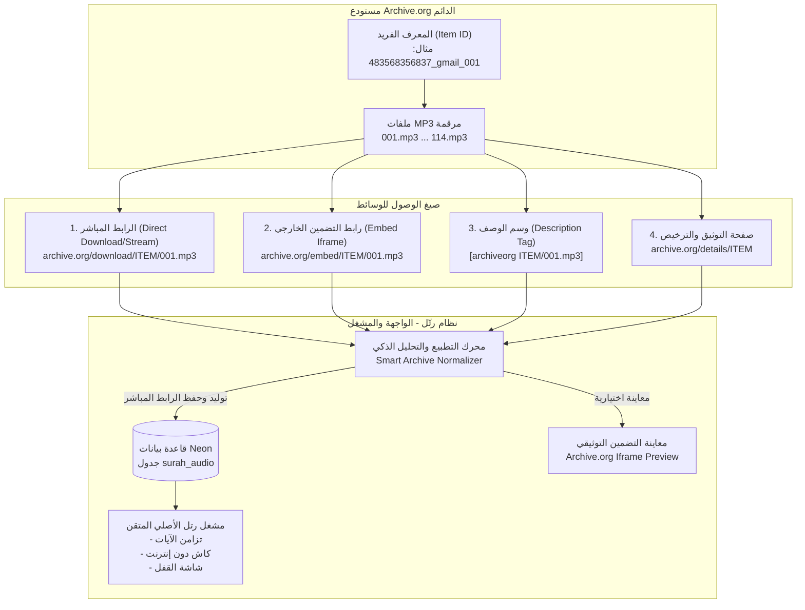
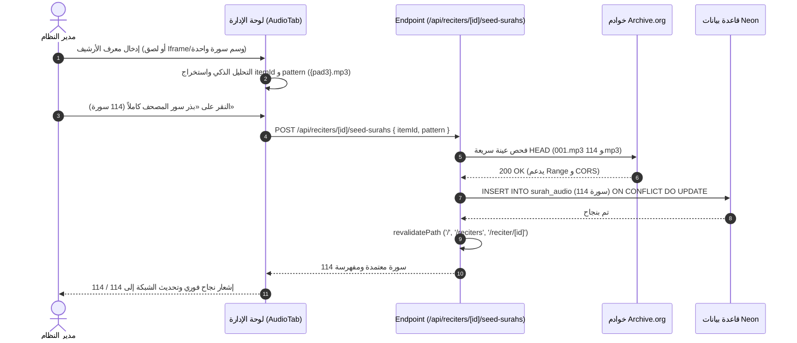

# خطة معمارية وعملية: إدارة التخزين الصوتي وتدفق السور وتضمين Archive.org في «رتّل»

## 1. الملخص التنفيذي والتشخيص الحالي

عند التعامل مع مكتبة التلاوات القرآنية الصوتية المعتمدة في منصة **«رتّل»**، يعتمد المشروع على خوادم **Archive.org** كمستودع تخزين صوتي دائم وغير محدود (Permanent Archival Storage). 

لكن يواجه المشرف (Admin) والمستخدم التحديات التالية عند إضافة المقاطع أو التضمين:
1. **تعدد صيغ روابط Archive.org:**
   - كود التضمين القياسي (HTML Iframe Embed):
     ```html
     <iframe src="https://archive.org/embed/483568356837_gmail_001/001.mp3" width="500" height="30" frameborder="0" webkitallowfullscreen="true" mozallowfullscreen="true" allowfullscreen=""></iframe>
     ```
   - وسم التضمين في حقول الوصف (Archive Description Embed Tag):
     ```text
     [archiveorg 483568356837_gmail_001/001.mp3 width=640 height=30 frameborder=0 webkitallowfullscreen=true mozallowfullscreen=true]
     ```
   - رابط صفحة التفاصيل (Details Page URL):
     `https://archive.org/details/483568356837_gmail_001/001.mp3`
   - الرابط المباشر للتحميل والبث (Direct Stream URL):
     `https://archive.org/download/483568356837_gmail_001/001.mp3`
2. **التعارض بين كود الـ Embed والمشغل الأصلي:**
   - المشغل المدمج في رتل (Custom Player) يتطلب رابط ملف صوتي مباشر (Direct MP3) يدعم بروتوكول `Range: bytes` لتقطيع الآيات بدقة وتزامن النص (Ayah Timings) والتخزين دون إنترنت (Offline Caching).
   - إذا تم حفظ كود الـ Iframe أو رابط الـ details كملف صوتي، فإن المشغل يتعطل لأنه يستقبل صفحة HTML بدلاً من تيار صوتي.
3. **عائق إدخال 114 سورة يدوياً:**
   - إدخال سور المصحف سورة سورة يدوياً لكل قارئ يمثل عبئاً تشغيلياً كبيراً، في حين أن معظم مجموعات Archive.org تعتمد تسمية نمطية قياسية (`001.mp3` حتى `114.mp3`).
4. **تصلب مسار الروابط في المشغل:**
   - كان المشغل يفترض سابقاً مساراً ثابتاً بصيغة `ratil-${reciterId}`، مما يعطل أي قارئ مرفوع بمعرف مخصص مثل `483568356837_gmail_001`.

---

## 2. قواعد التخزين الصوتي (Audio Storage Rules & Architecture)



### المقارنة المعمارية بين أنماط الروابط:

| الخاصية | 1. الرابط المباشر (`download/`) | 2. كود التضمين (`embed/` Iframe) | 3. وسم الوصف (`[archiveorg]`) | 4. صفحة التفاصيل (`details/`) |
| :--- | :--- | :--- | :--- | :--- |
| **نوع المحتوى** | تيار MP3 صوتي مباشر (`audio/mpeg`) | صفحة HTML تفاعلية بمشغل مدمج | نص وصفي مخصص لأرشيف الإنترنت | صفحة ويب كاملة لبيانات المادة |
| **دعم Range Requests (HTTP 206)** | نعم (بث سريع وقفز فوري) | لا ينطبق (المشغل الخارجي يديرها) | لا ينطبق | لا ينطبق |
| **دعم CORS والتخزين دون إنترنت** | مدعوم (`Access-Control-Allow-Origin: *`) | غير مدعوم في الكاش | غير مدعوم | غير مدعوم |
| **تزامن الآيات (Ayah Highlight)** | مدعوم بالكامل عبر HTML5 Audio | مستحيل (Sandbox Iframe) | مستحيل | مستحيل |
| **الاستخدام في «رتّل»** | **الرابط الإلزامي للمشغل وقاعدة البيانات** | متاح كـ **معاينة توثيقية إضافية** | يُحلل ويُحوّل إلى الرابط المباشر | رابط المصدر والترخيص |

---

## 3. محرك الاستيعاب والتحليل الذكي (Smart Ingestion Engine)

لتمكين المشرف من نسخ ولصق أي صيغة دون قلق، ننشئ خدمة معيارية مخصصة:
`features/audio/utils/archive-parser.utils.ts`

### منطق التحليل والتطبيع (Normalization Logic):
- **المدخل المقبول:**
  - كود `<iframe>` كامل.
  - وسم `[archiveorg ...]` المأخوذ من وصف المادة.
  - رابط `https://archive.org/embed/...`
  - رابط `https://archive.org/details/...`
  - رابط `https://archive.org/download/...`
  - أو مجرد معرف المادة: `483568356837_gmail_001`
- **المخرجات الناتجة تلقائياً:**
  1. `itemId`: المعرف النقي (مثال: `483568356837_gmail_001`).
  2. `fileName`: اسم الملف الصوتي (مثال: `001.mp3`).
  3. `surahNumber`: رقم السورة المستنتج آلياً (مثال: `1`).
  4. `directAudioUrl`: رابط البث المباشر المعتمد في `surah_audio`.
  5. `embedUrl`: رابط التضمين.
  6. `iframeCode`: كود Iframe قياسي جاهز للعرض.
  7. `detailsUrl`: رابط المصدر والترخيص.

---

## 4. تدفق بذر السور الـ 114 دفعة واحدة (Bulk Surah Flow)

بدلاً من إضافة سورة واحدة تلو الأخرى:



---

## 5. انعكاس الصوت في المشغل والواجهة (Playback & UI Reflection)

### 1. المشغل الأصلي (Ratil Native Player)
- تحديث `features/player/utils/player.utils.ts` و `useAudioPlayer.ts`:
  - إذا كانت السورة مسجلة في `surah_audio` ولها `audio_url`، يتم استخدامه مباشرة.
  - إذا لم تكن موجودة، يتم استخراج `itemId` من `reciter.source_url` وبناء الرابط المباشر `https://archive.org/download/{itemId}/{pad3}.mp3`.
  - عدم الاقتصار على الاسم الافتراضي `ratil-${reciterId}`.

### 2. التضمين التوثيقي البديل (Archive.org Embed Preview)
- في لوحة الإدارة (`AudioTab`) وفي صفحة تفاصيل القارئ/السورة:
  - إضافة زر أو تبويب جانبي خفيف: **«معاينة المشغل الرسمي من Archive.org»**.
  - يعرض الـ Iframe بدقة ليتمكن المشرف أو المستخدم من مقارنة البث والتأكد من مطابقة الملف المرفوع على الأرشيف.

---

## 6. خطة مراحل التنفيذ التقنية المجدولة

### المرحلة 1: وحدة التحليل والتطبيع الذكي
- إنشاء [features/audio/utils/archive-parser.utils.ts](file:///home/ammar/ratil/features/audio/utils/archive-parser.utils.ts) وفق معيار [@feature-modular-structure](file:///home/ammar/ratil/.agents/skills/feature-modular-structure/SKILL.md).
- دعم معالجة Iframe و `[archiveorg]` وروابط التفاصيل والتحميل.

### المرحلة 2: مسار API لبذر السور دفعة واحدة
- إنشاء [app/api/reciters/[id]/seed-surahs/route.ts](file:///home/ammar/ratil/app/api/reciters/[id]/seed-surahs/route.ts).
- تصحيح رابط سورة الفاتحة للقارئ `fares_abed` في Neon DB وبذر كافة السور الـ 114 المتبقية له.

### المرحلة 3: تحديث مشغل رتل الأصلي
- ترقية `features/player/utils/player.utils.ts` ليعتمد على روابط الأرشيف الديناميكية المستخرجة من بيانات القارئ.
- اختبار تشغيل السور والانتقال بين القراء وسرعات التشغيل.

### المرحلة 4: ترقية لوحة الإدارة (AudioTab & RecitersTab)
- دعم حقل اللصق المتعدد الأشكال (Smart Paste) في [features/admin/components/AudioTab.tsx](file:///home/ammar/ratil/features/admin/components/AudioTab.tsx).
- إضافة زر البذر التلقائي لـ 114 سورة بنقرة واحدة.
- إضافة معاينة مشغل الـ Iframe المدمج.

### المرحلة 5: الاختبار الشامل والمطابقة المعمارية
- اختبار تشغيل سورة الفاتحة والناس لسائر القرّاء المعتمدين ومن ضمنهم فارس عباد.
- التأكد من سلامة كاش الصفحات وانعكاس التغييرات فوراً.
