# شاشات مشروع رتل — Stitch Screens

**اسم المشروع:** Ratil Admin Quran Platform  
**معرف المشروع في Stitch:** `339375098252776117`  
**تاريخ التحميل:** 2026-10-27  
**إجمالي الشاشات:** 17 شاشة  

---

## فهرس الشاشات المرجعية الشامل

| # | اسم الشاشة | المعرف (ID) | الجهاز | الأبعاد | كود HTML | لقطة الشاشة |
|---|---|---|---|---|---|---|
| 1 | **إنشاء حساب — رتل** | `297ca81b...` | كمبيوتر 💻 | 2560×2674 | [01_signup.html](./01_signup.html) | [عرض الصورة](./01_signup.png) |
| 2 | **تسجيل الدخول — رتل** | `6d0f7ed7...` | كمبيوتر 💻 | 2560×2114 | [02_login.html](./02_login.html) | [عرض الصورة](./02_login.png) |
| 3 | **الرئيسية — رتل** | `58d8e75a...` | جوال 📱 | 780×2272 | [03_home_mobile.html](./03_home_mobile.html) | [عرض الصورة](./03_home_mobile.png) |
| 4 | **فهرس القرّاء — رتل** | `7ec8c0de...` | جوال 📱 | 780×2282 | [04_reciters_index.html](./04_reciters_index.html) | [عرض الصورة](./04_reciters_index.png) |
| 5 | **الرئيسية — رتل (كمبيوتر)** | `e016b21e...` | كمبيوتر 💻 | 2560×2940 | [05_home_desktop.html](./05_home_desktop.html) | [عرض الصورة](./05_home_desktop.png) |
| 6 | **سورة الكهف — استماع وقراءة** | `0983f101...` | جوال 📱 | 780×3522 | [06_surah_kahf.html](./06_surah_kahf.html) | [عرض الصورة](./06_surah_kahf.png) |
| 7 | **ملف القارئ: المنشاوي — رتل** | `4af62fa5...` | جوال 📱 | 780×2116 | [07_reciter_minshawi.html](./07_reciter_minshawi.html) | [عرض الصورة](./07_reciter_minshawi.png) |
| 8 | **تصفح المصحف — رتل (كمبيوتر)** | `2e714475...` | كمبيوتر 💻 | 2560×5164 | [08_browse_mushaf_desktop.html](./08_browse_mushaf_desktop.html) | [عرض الصورة](./08_browse_mushaf_desktop.png) |
| 9 | **اختيار القارئ — رتل** | `389713e0...` | جوال 📱 | 780×1768 | [09_choose_reciter.html](./09_choose_reciter.html) | [عرض الصورة](./09_choose_reciter.png) |
| 10 | **تصفح المصحف — رتل** | `86dfd06a...` | جوال 📱 | 780×2900 | [10_browse_mushaf_mobile.html](./10_browse_mushaf_mobile.html) | [عرض الصورة](./10_browse_mushaf_mobile.png) |
| 11 | **رتل الإدارية — نظرة عامة** | `3a74510f...` | كمبيوتر 💻 | 2560×3128 | [11_admin_overview.html](./11_admin_overview.html) | [عرض الصورة](./11_admin_overview.png) |
| 12 | **البلاغات والأخطاء — رتل** | `263d891d...` | كمبيوتر 💻 | 2560×3144 | [12_reports_errors.html](./12_reports_errors.html) | [عرض الصورة](./12_reports_errors.png) |
| 13 | **إدارة الملفات الصوتية — رتل** | `52752d61...` | كمبيوتر 💻 | 2560×2100 | [13_audio_files.html](./13_audio_files.html) | [عرض الصورة](./13_audio_files.png) |
| 14 | **سلامة النص القرآني — رتل** | `1563636b...` | كمبيوتر 💻 | 2560×2744 | [14_text_integrity.html](./14_text_integrity.html) | [عرض الصورة](./14_text_integrity.png) |
| 15 | **إدارة القرّاء — رتل** | `d670546c...` | كمبيوتر 💻 | 2560×2432 | [15_reciters_admin.html](./15_reciters_admin.html) | [عرض الصورة](./15_reciters_admin.png) |
| 16 | **المحفوظات — رتل (كمبيوتر)** | `da974ce3...` | كمبيوتر 💻 | 2560×4776 | [16_bookmarks_desktop.html](./16_bookmarks_desktop.html) | [عرض الصورة](./16_bookmarks_desktop.png) |
| 17 | **القرّاء — رتل (كمبيوتر)** | `14bc4ed7...` | كمبيوتر 💻 | 2560×3594 | [17_reciters_desktop.html](./17_reciters_desktop.html) | [عرض الصورة](./17_reciters_desktop.png) |

---

## تفاصيل الشاشات

### 1. إنشاء حساب — رتل
- **معرف الشاشة الكامل:** `297ca81b260f435689d8ee5e046f22dd`
- **نوع الجهاز:** شاشة كمبيوتر (Desktop)
- **الأبعاد الأصلية:** 2560 × 2674 بكسل
- **ملفات الشاشة:**
  - المجلد المستقل: [`stitch-screens/01_signup/`](./01_signup/)
  - كود الواجهة: [`01_signup.html`](./01_signup.html) ([المجلد](./01_signup/index.html))
  - لقطة الشاشة: [`01_signup.png`](./01_signup.png) ([المجلد](./01_signup/screenshot.png))
  - البيانات الوصفية: [`01_signup/metadata.json`](./01_signup/metadata.json)

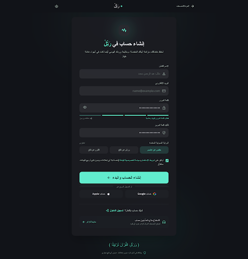

---

### 2. تسجيل الدخول — رتل
- **معرف الشاشة الكامل:** `6d0f7ed710294c3088a39627acb4a8ff`
- **نوع الجهاز:** شاشة كمبيوتر (Desktop)
- **الأبعاد الأصلية:** 2560 × 2114 بكسل
- **ملفات الشاشة:**
  - المجلد المستقل: [`stitch-screens/02_login/`](./02_login/)
  - كود الواجهة: [`02_login.html`](./02_login.html) ([المجلد](./02_login/index.html))
  - لقطة الشاشة: [`02_login.png`](./02_login.png) ([المجلد](./02_login/screenshot.png))
  - البيانات الوصفية: [`02_login/metadata.json`](./02_login/metadata.json)

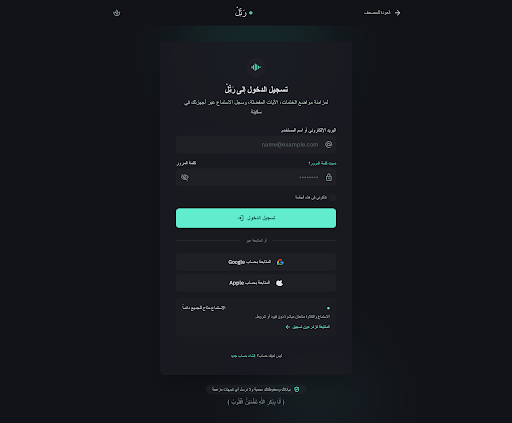

---

### 3. الرئيسية — رتل
- **معرف الشاشة الكامل:** `58d8e75a787944ed949346279a61470d`
- **نوع الجهاز:** شاشة جوال (Mobile)
- **الأبعاد الأصلية:** 780 × 2272 بكسل
- **ملفات الشاشة:**
  - المجلد المستقل: [`stitch-screens/03_home_mobile/`](./03_home_mobile/)
  - كود الواجهة: [`03_home_mobile.html`](./03_home_mobile.html) ([المجلد](./03_home_mobile/index.html))
  - لقطة الشاشة: [`03_home_mobile.png`](./03_home_mobile.png) ([المجلد](./03_home_mobile/screenshot.png))
  - البيانات الوصفية: [`03_home_mobile/metadata.json`](./03_home_mobile/metadata.json)

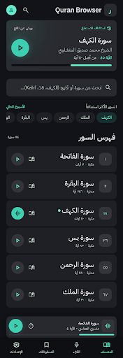

---

### 4. فهرس القرّاء — رتل
- **معرف الشاشة الكامل:** `7ec8c0dece52487db2594b7110b96f23`
- **نوع الجهاز:** شاشة جوال (Mobile)
- **الأبعاد الأصلية:** 780 × 2282 بكسل
- **ملفات الشاشة:**
  - المجلد المستقل: [`stitch-screens/04_reciters_index/`](./04_reciters_index/)
  - كود الواجهة: [`04_reciters_index.html`](./04_reciters_index.html) ([المجلد](./04_reciters_index/index.html))
  - لقطة الشاشة: [`04_reciters_index.png`](./04_reciters_index.png) ([المجلد](./04_reciters_index/screenshot.png))
  - البيانات الوصفية: [`04_reciters_index/metadata.json`](./04_reciters_index/metadata.json)

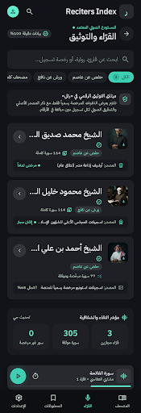

---

### 5. الرئيسية — رتل (كمبيوتر)
- **معرف الشاشة الكامل:** `e016b21e00ad44a7b1021fa5936f2bd9`
- **نوع الجهاز:** شاشة كمبيوتر (Desktop)
- **الأبعاد الأصلية:** 2560 × 2940 بكسل
- **ملفات الشاشة:**
  - المجلد المستقل: [`stitch-screens/05_home_desktop/`](./05_home_desktop/)
  - كود الواجهة: [`05_home_desktop.html`](./05_home_desktop.html) ([المجلد](./05_home_desktop/index.html))
  - لقطة الشاشة: [`05_home_desktop.png`](./05_home_desktop.png) ([المجلد](./05_home_desktop/screenshot.png))
  - البيانات الوصفية: [`05_home_desktop/metadata.json`](./05_home_desktop/metadata.json)

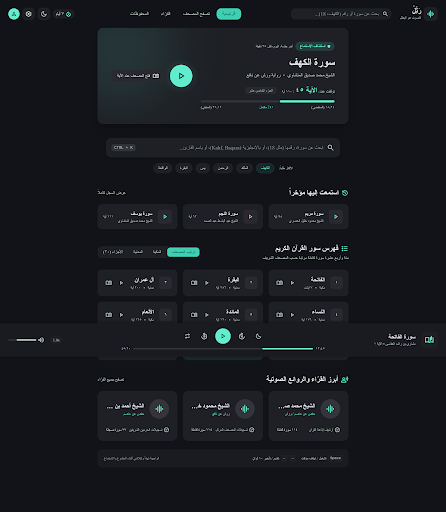

---

### 6. سورة الكهف — استماع وقراءة
- **معرف الشاشة الكامل:** `0983f1013d3b40428848c12f8c142893`
- **نوع الجهاز:** شاشة جوال (Mobile)
- **الأبعاد الأصلية:** 780 × 3522 بكسل
- **ملفات الشاشة:**
  - المجلد المستقل: [`stitch-screens/06_surah_kahf/`](./06_surah_kahf/)
  - كود الواجهة: [`06_surah_kahf.html`](./06_surah_kahf.html) ([المجلد](./06_surah_kahf/index.html))
  - لقطة الشاشة: [`06_surah_kahf.png`](./06_surah_kahf.png) ([المجلد](./06_surah_kahf/screenshot.png))
  - البيانات الوصفية: [`06_surah_kahf/metadata.json`](./06_surah_kahf/metadata.json)

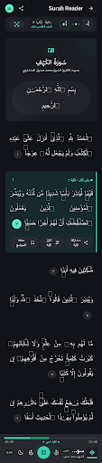

---

### 7. ملف القارئ: المنشاوي — رتل
- **معرف الشاشة الكامل:** `4af62fa5387442b0b9ad59532ff4d909`
- **نوع الجهاز:** شاشة جوال (Mobile)
- **الأبعاد الأصلية:** 780 × 2116 بكسل
- **ملفات الشاشة:**
  - المجلد المستقل: [`stitch-screens/07_reciter_minshawi/`](./07_reciter_minshawi/)
  - كود الواجهة: [`07_reciter_minshawi.html`](./07_reciter_minshawi.html) ([المجلد](./07_reciter_minshawi/index.html))
  - لقطة الشاشة: [`07_reciter_minshawi.png`](./07_reciter_minshawi.png) ([المجلد](./07_reciter_minshawi/screenshot.png))
  - البيانات الوصفية: [`07_reciter_minshawi/metadata.json`](./07_reciter_minshawi/metadata.json)

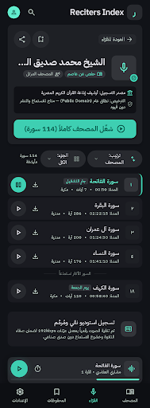

---

### 8. تصفح المصحف — رتل (كمبيوتر)
- **معرف الشاشة الكامل:** `2e71447593f24705a86181cbd1484cd0`
- **نوع الجهاز:** شاشة كمبيوتر (Desktop)
- **الأبعاد الأصلية:** 2560 × 5164 بكسل
- **ملفات الشاشة:**
  - المجلد المستقل: [`stitch-screens/08_browse_mushaf_desktop/`](./08_browse_mushaf_desktop/)
  - كود الواجهة: [`08_browse_mushaf_desktop.html`](./08_browse_mushaf_desktop.html) ([المجلد](./08_browse_mushaf_desktop/index.html))
  - لقطة الشاشة: [`08_browse_mushaf_desktop.png`](./08_browse_mushaf_desktop.png) ([المجلد](./08_browse_mushaf_desktop/screenshot.png))
  - البيانات الوصفية: [`08_browse_mushaf_desktop/metadata.json`](./08_browse_mushaf_desktop/metadata.json)

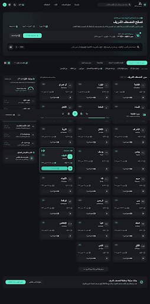

---

### 9. اختيار القارئ — رتل
- **معرف الشاشة الكامل:** `389713e03933438b8cf4c4e4f425a847`
- **نوع الجهاز:** شاشة جوال (Mobile)
- **الأبعاد الأصلية:** 780 × 1768 بكسل
- **ملفات الشاشة:**
  - المجلد المستقل: [`stitch-screens/09_choose_reciter/`](./09_choose_reciter/)
  - كود الواجهة: [`09_choose_reciter.html`](./09_choose_reciter.html) ([المجلد](./09_choose_reciter/index.html))
  - لقطة الشاشة: [`09_choose_reciter.png`](./09_choose_reciter.png) ([المجلد](./09_choose_reciter/screenshot.png))
  - البيانات الوصفية: [`09_choose_reciter/metadata.json`](./09_choose_reciter/metadata.json)

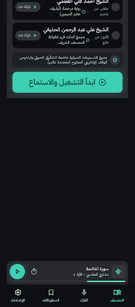

---

### 10. تصفح المصحف — رتل
- **معرف الشاشة الكامل:** `86dfd06aff3342e688354ea527c66ead`
- **نوع الجهاز:** شاشة جوال (Mobile)
- **الأبعاد الأصلية:** 780 × 2900 بكسل
- **ملفات الشاشة:**
  - المجلد المستقل: [`stitch-screens/10_browse_mushaf_mobile/`](./10_browse_mushaf_mobile/)
  - كود الواجهة: [`10_browse_mushaf_mobile.html`](./10_browse_mushaf_mobile.html) ([المجلد](./10_browse_mushaf_mobile/index.html))
  - لقطة الشاشة: [`10_browse_mushaf_mobile.png`](./10_browse_mushaf_mobile.png) ([المجلد](./10_browse_mushaf_mobile/screenshot.png))
  - البيانات الوصفية: [`10_browse_mushaf_mobile/metadata.json`](./10_browse_mushaf_mobile/metadata.json)

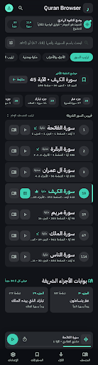

---

### 11. رتل الإدارية — نظرة عامة
- **معرف الشاشة الكامل:** `3a74510ff2bc462298d4cfb0fd23a3ec`
- **نوع الجهاز:** شاشة كمبيوتر (Desktop)
- **الأبعاد الأصلية:** 2560 × 3128 بكسل
- **ملفات الشاشة:**
  - المجلد المستقل: [`stitch-screens/11_admin_overview/`](./11_admin_overview/)
  - كود الواجهة: [`11_admin_overview.html`](./11_admin_overview.html) ([المجلد](./11_admin_overview/index.html))
  - لقطة الشاشة: [`11_admin_overview.png`](./11_admin_overview.png) ([المجلد](./11_admin_overview/screenshot.png))
  - البيانات الوصفية: [`11_admin_overview/metadata.json`](./11_admin_overview/metadata.json)

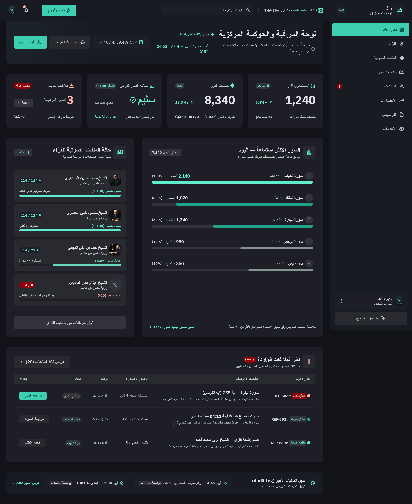

---

### 12. البلاغات والأخطاء — رتل
- **معرف الشاشة الكامل:** `263d891d10c946afba4a497b0cf63fba`
- **نوع الجهاز:** شاشة كمبيوتر (Desktop)
- **الأبعاد الأصلية:** 2560 × 3144 بكسل
- **ملفات الشاشة:**
  - المجلد المستقل: [`stitch-screens/12_reports_errors/`](./12_reports_errors/)
  - كود الواجهة: [`12_reports_errors.html`](./12_reports_errors.html) ([المجلد](./12_reports_errors/index.html))
  - لقطة الشاشة: [`12_reports_errors.png`](./12_reports_errors.png) ([المجلد](./12_reports_errors/screenshot.png))
  - البيانات الوصفية: [`12_reports_errors/metadata.json`](./12_reports_errors/metadata.json)

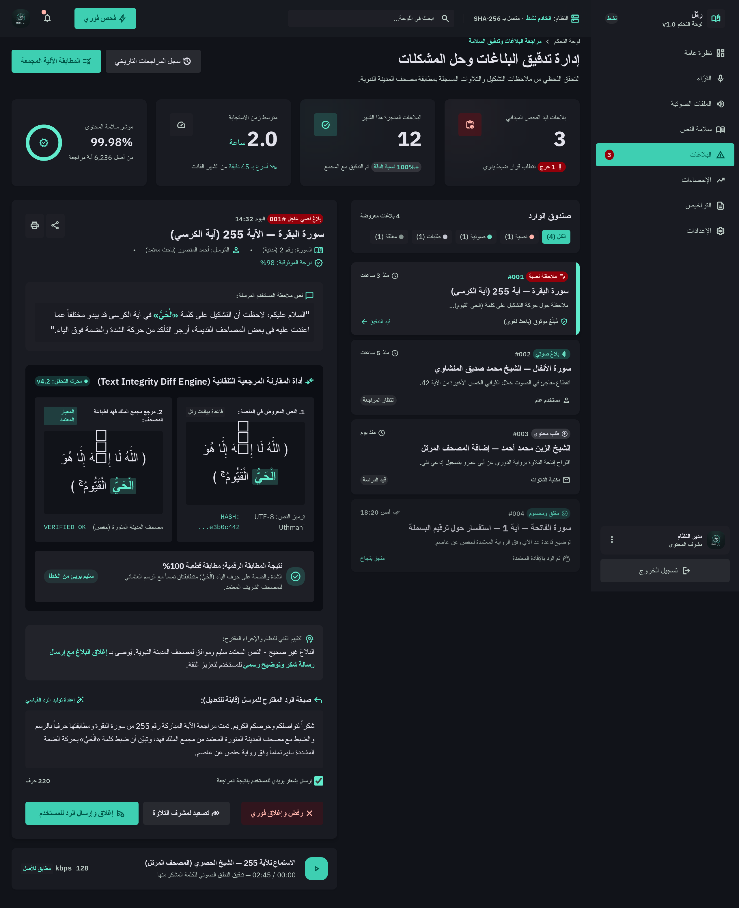

---

### 13. إدارة الملفات الصوتية — رتل
- **معرف الشاشة الكامل:** `52752d61920e4302994540a7636f53fb`
- **نوع الجهاز:** شاشة كمبيوتر (Desktop)
- **الأبعاد الأصلية:** 2560 × 2100 بكسل
- **ملفات الشاشة:**
  - المجلد المستقل: [`stitch-screens/13_audio_files/`](./13_audio_files/)
  - كود الواجهة: [`13_audio_files.html`](./13_audio_files.html) ([المجلد](./13_audio_files/index.html))
  - لقطة الشاشة: [`13_audio_files.png`](./13_audio_files.png) ([المجلد](./13_audio_files/screenshot.png))
  - البيانات الوصفية: [`13_audio_files/metadata.json`](./13_audio_files/metadata.json)

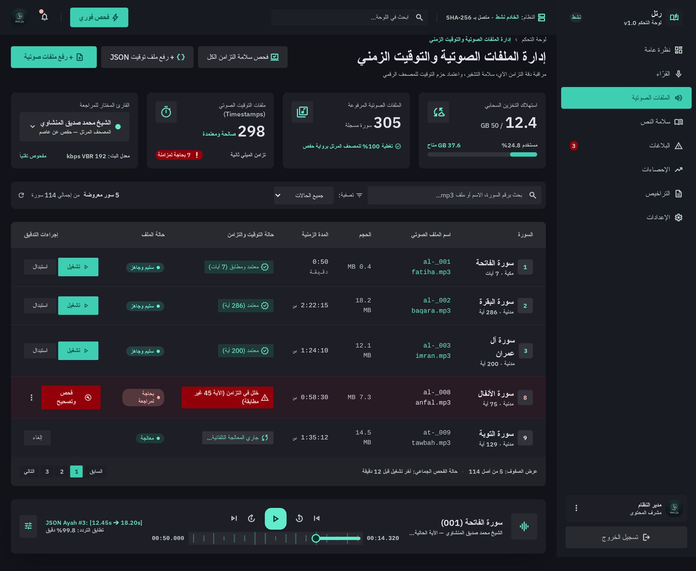

---

### 14. سلامة النص القرآني — رتل
- **معرف الشاشة الكامل:** `1563636b6775402eb736a4058a8477f7`
- **نوع الجهاز:** شاشة كمبيوتر (Desktop)
- **الأبعاد الأصلية:** 2560 × 2744 بكسل
- **ملفات الشاشة:**
  - المجلد المستقل: [`stitch-screens/14_text_integrity/`](./14_text_integrity/)
  - كود الواجهة: [`14_text_integrity.html`](./14_text_integrity.html) ([المجلد](./14_text_integrity/index.html))
  - لقطة الشاشة: [`14_text_integrity.png`](./14_text_integrity.png) ([المجلد](./14_text_integrity/screenshot.png))
  - البيانات الوصفية: [`14_text_integrity/metadata.json`](./14_text_integrity/metadata.json)

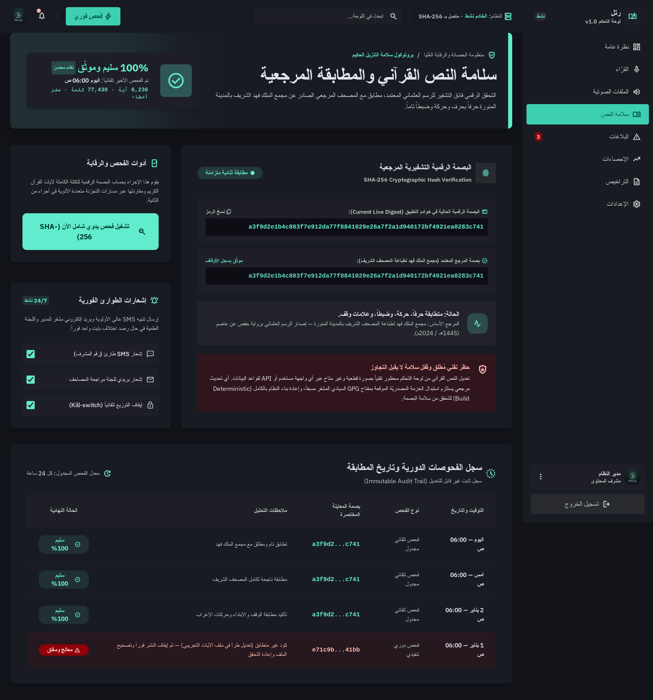

---

### 15. إدارة القرّاء — رتل
- **معرف الشاشة الكامل:** `d670546cc49243759a7a3047465e699e`
- **نوع الجهاز:** شاشة كمبيوتر (Desktop)
- **الأبعاد الأصلية:** 2560 × 2432 بكسل
- **ملفات الشاشة:**
  - المجلد المستقل: [`stitch-screens/15_reciters_admin/`](./15_reciters_admin/)
  - كود الواجهة: [`15_reciters_admin.html`](./15_reciters_admin.html) ([المجلد](./15_reciters_admin/index.html))
  - لقطة الشاشة: [`15_reciters_admin.png`](./15_reciters_admin.png) ([المجلد](./15_reciters_admin/screenshot.png))
  - البيانات الوصفية: [`15_reciters_admin/metadata.json`](./15_reciters_admin/metadata.json)

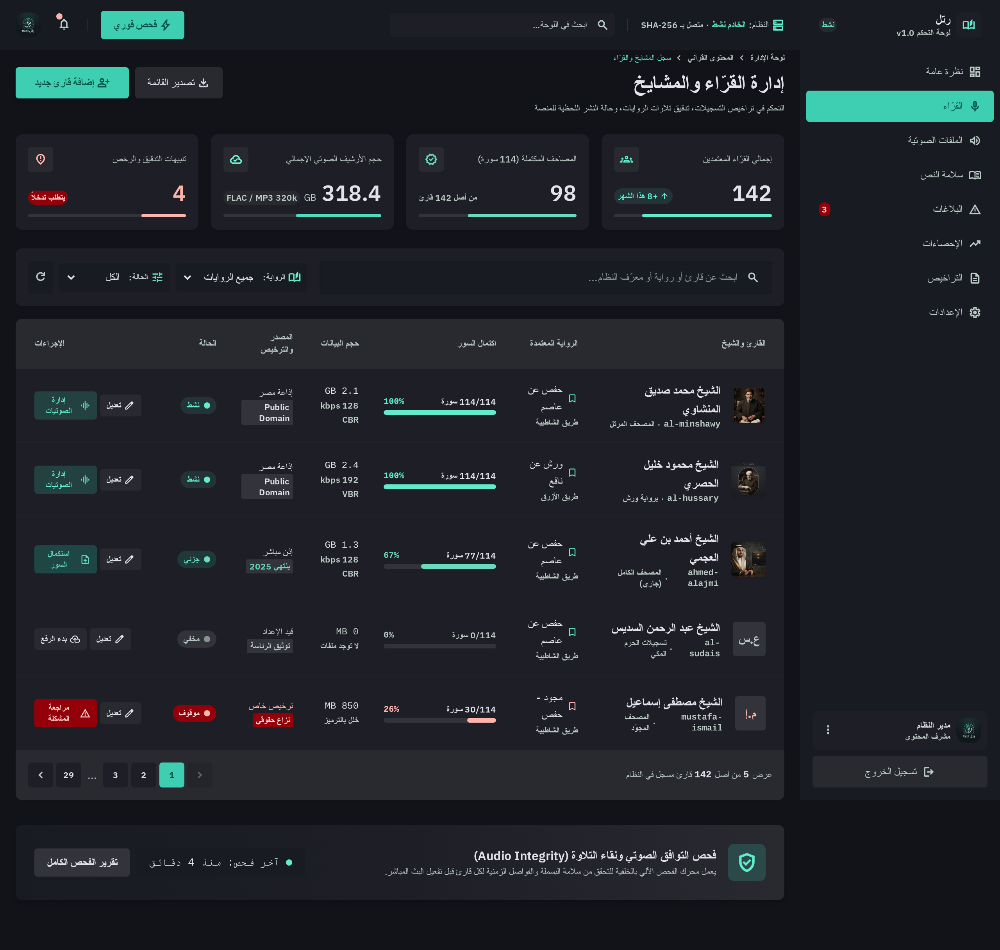

---

### 16. المحفوظات — رتل (كمبيوتر)
- **معرف الشاشة الكامل:** `da974ce37d0e45e897104cfa2bb0098c`
- **نوع الجهاز:** شاشة كمبيوتر (Desktop)
- **الأبعاد الأصلية:** 2560 × 4776 بكسل
- **ملفات الشاشة:**
  - المجلد المستقل: [`stitch-screens/16_bookmarks_desktop/`](./16_bookmarks_desktop/)
  - كود الواجهة: [`16_bookmarks_desktop.html`](./16_bookmarks_desktop.html) ([المجلد](./16_bookmarks_desktop/index.html))
  - لقطة الشاشة: [`16_bookmarks_desktop.png`](./16_bookmarks_desktop.png) ([المجلد](./16_bookmarks_desktop/screenshot.png))
  - البيانات الوصفية: [`16_bookmarks_desktop/metadata.json`](./16_bookmarks_desktop/metadata.json)

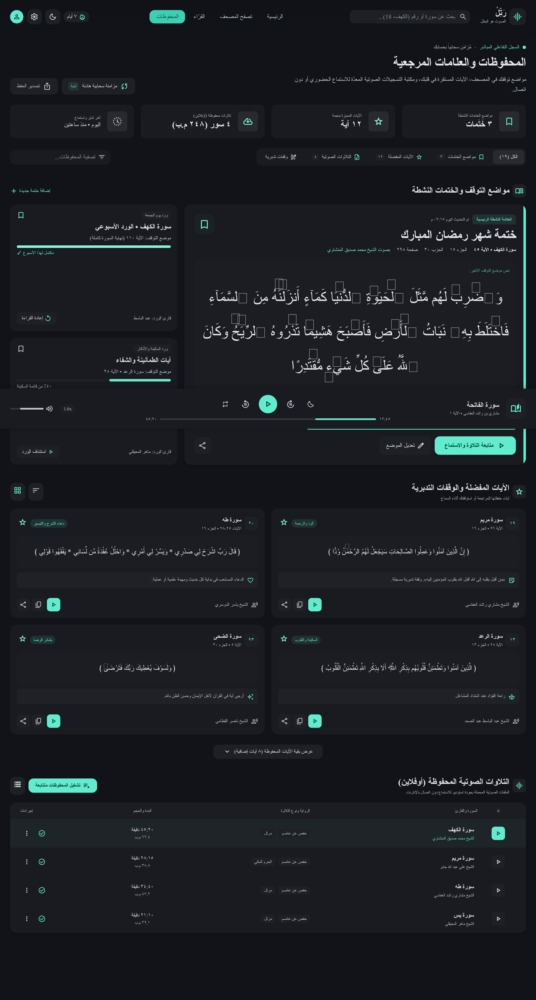

---

### 17. القرّاء — رتل (كمبيوتر)
- **معرف الشاشة الكامل:** `14bc4ed72f354ca183c8c00f94897251`
- **نوع الجهاز:** شاشة كمبيوتر (Desktop)
- **الأبعاد الأصلية:** 2560 × 3594 بكسل
- **ملفات الشاشة:**
  - المجلد المستقل: [`stitch-screens/17_reciters_desktop/`](./17_reciters_desktop/)
  - كود الواجهة: [`17_reciters_desktop.html`](./17_reciters_desktop.html) ([المجلد](./17_reciters_desktop/index.html))
  - لقطة الشاشة: [`17_reciters_desktop.png`](./17_reciters_desktop.png) ([المجلد](./17_reciters_desktop/screenshot.png))
  - البيانات الوصفية: [`17_reciters_desktop/metadata.json`](./17_reciters_desktop/metadata.json)

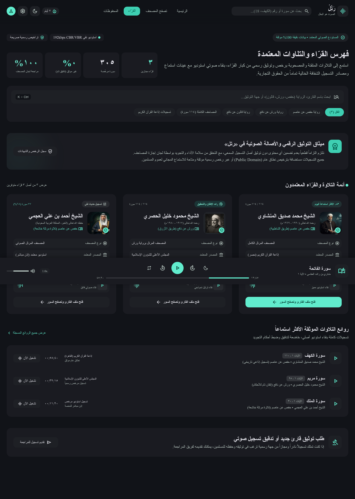

---
